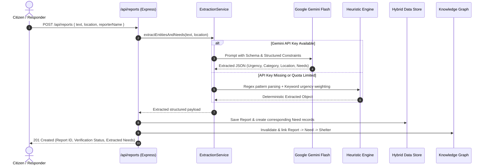
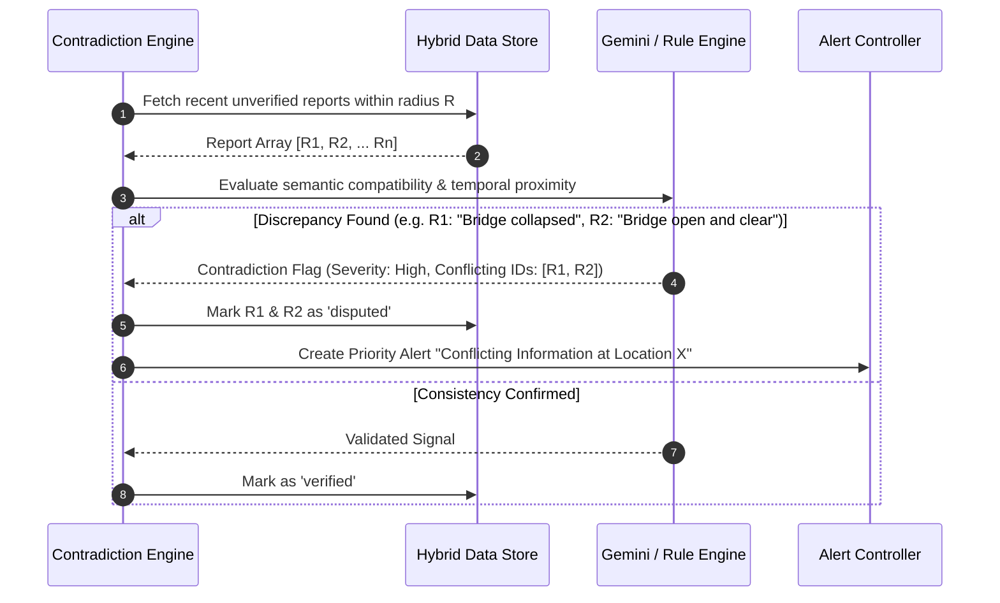
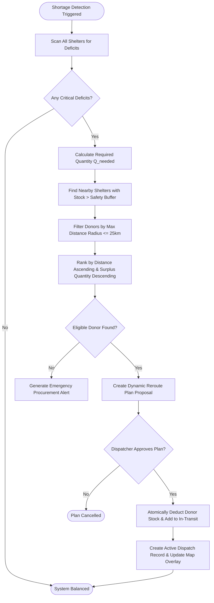
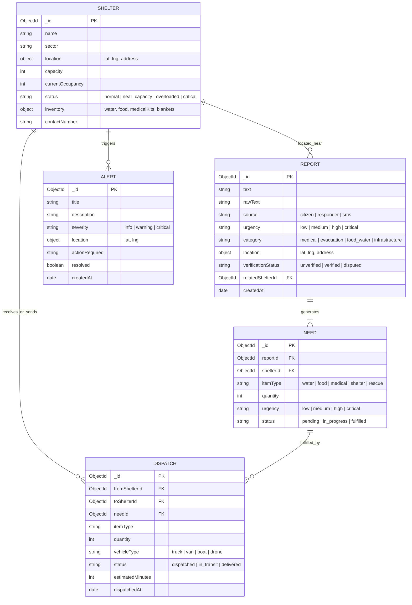

# System Architecture & Technical Design Document

**Project:** ReliefGraph AI – Intelligent Disaster Response & Supply-Chain Coordination Platform  
**Version:** 1.0.0  
**Status:** Approved & Implemented  
**Date:** October 2026  

---

## 1. Architectural Overview

ReliefGraph AI is designed as a resilient, real-time, fault-tolerant coordination system for disaster management and humanitarian logistics. It bridges unverified emergency citizen reports, automated AI information extraction, spatial resource mapping, and algorithmic supply-chain dispatching.

### Core Architectural Principles
1. **Zero-Downtime Resilience & Hybrid Storage:** The application operates identically in both enterprise containerized environments (with MongoDB clusters) and offline/local edge environments (via an in-memory hybrid store).
2. **Graceful AI Degradation:** If Google Gemini API quotas are exhausted, keys are missing, or network connectivity is severed, the system automatically falls back to an internal heuristic natural language rule engine.
3. **Decoupled Frontend-Backend Topology:** The client is an optimized Single Page Application (SPA) built with React 19 and Vite, served via an Nginx reverse proxy. The backend is an asynchronous Node.js/Express service exposing RESTful APIs.
4. **Graph-Centric Relational Modeling:** Complex disaster relationships (reports $\rightarrow$ extracted needs $\rightarrow$ affected shelters $\rightarrow$ supply dispatches $\rightarrow$ transit routes) are modeled as an interconnected knowledge graph.

---

## 2. High-Level System Architecture

```
+----------------------------------------------------------------------------------------------------+
|                                         PRESENTATION TIER                                          |
|                                                                                                    |
|    +------------------------------------------------------------------------------------------+    |
|    |                                  React 19 / Vite SPA                                     |    |
|    |  +-------------------+  +-------------------+  +-------------------+  +---------------+  |    |
|    |  | Leaflet GIS Map   |  | Vis-Network Graph |  | Emergency Triage  |  | Smart Reroute |  |    |
|    |  | & Sector Radar    |  | Visualizer        |  | Feed & Filter     |  | Modal System  |  |    |
|    |  +-------------------+  +-------------------+  +-------------------+  +---------------+  |    |
|    |  +------------------------------------------------------------------------------------+  |    |
|    |  |  Tailwind CSS UI Component Library + Lucide Icons + Optimistic State Reducers      |  |    |
|    |  +------------------------------------------------------------------------------------+  |    |
|    +------------------------------------------------------------------------------------------+    |
+--------------------------------------------------|-------------------------------------------------+
                                                   | HTTP / REST (JSON)
                                                   v
+----------------------------------------------------------------------------------------------------+
|                                       INGRESS & REVERSE PROXY                                      |
|                                                                                                    |
|    +------------------------------------------------------------------------------------------+    |
|    |                                      Nginx Alpine Proxy                                  |    |
|    |            Routes /api/* -> Node.js Backend:5000 | Serves Production SPA Assets           |    |
|    +------------------------------------------------------------------------------------------+    |
+--------------------------------------------------|-------------------------------------------------+
                                                   | Reverse Proxy Forwarding
                                                   v
+----------------------------------------------------------------------------------------------------+
|                                        APPLICATION BACKEND                                         |
|                                                                                                    |
|    +------------------------------------------------------------------------------------------+    |
|    |                                 Node.js / Express Core Server                            |    |
|    |  +------------------+  +-------------------+  +-------------------+  +----------------+  |    |
|    |  | Report Controller|  | Shelter Controller|  | Dispatch Router   |  | Graph Router   |  |    |
|    |  +------------------+  +-------------------+  +-------------------+  +----------------+  |    |
|    |                                                                                          |    |
|    |  +------------------------------------------------------------------------------------+  |    |
|    |  |                             Intelligence & Processing Engine                       |  |    |
|    |  |  - Extraction Service (Gemini 3.8/2.0/1.5 Flash -> Local Heuristic NLP Engine)     |  |    |
|    |  |  - Contradiction Service (Cross-Report Verification & Misinformation Detection)     |  |    |
|    |  |  - Reroute Optimizer (Shortage Analysis, Donor Matching, Transit Routing)           |  |    |
|    |  |  - Knowledge Graph Generator (Entities, Dynamic Nodes & Directional Relational Edges)| |    |
|    |  +------------------------------------------------------------------------------------+  |    |
|    +------------------------------------------------------------------------------------------+    |
+--------------------------------------------------|-------------------------------------------------+
                                                   | Hybrid Data Adapter
                                                   v
+----------------------------------------------------------------------------------------------------+
|                                            DATA LAYER                                              |
|                                                                                                    |
|    +------------------------------------------------+  +--------------------------------------+    |
|    |               MongoDB (Primary)                |  |       In-Memory Store (Fallback)     |    |
|    |  - Mongoose Schemas & Model Instances          |  |  - Zero-latency MemoryCollection     |    |
|    |  - Full persistence across container restarts  |  |  - Dotted path updating & filtering  |    |
|    |  - Auto-fails over if DB unavailable           |  |  - Zero native driver buffer locking |    |
|    +------------------------------------------------+  +--------------------------------------+    |
+----------------------------------------------------------------------------------------------------+
```

---

## 3. Component Breakdown & Responsibilities

### 3.1 Client Tier (`/frontend`)
The client tier is built on **React 19**, bundled using **Vite 6**, and styled with **Tailwind CSS**.

*   **`DisasterMap.jsx` (Spatial Intelligence):**
    *   Renders geographic boundaries, shelter pins, active disaster coordinates, and dynamic supply reroute paths.
    *   Implements animated fly-to transitions upon selecting shelters or alerts.
    *   Highlights severity with color-coded pulsing radar rings.
*   **`ReliefKnowledgeGraph.jsx` (Topology & Relationships):**
    *   Built on `vis-network` canvas engine.
    *   Preserves user zoom, drag, and pan state by mutating graph data using non-destructive `.setData()` passes rather than recreating DOM instances.
    *   Categorizes nodes into Shelters (Green/Orange/Red based on occupancy), Reports (Amber), Needs (Purple), and Dispatches (Cyan).
*   **`EmergencyReportsFeed.jsx` & `PriorityAlerts.jsx` (Triage):**
    *   Live feed displaying real-time incoming reports.
    *   Shows automated verification badges (`Verified`, `Unverified`, `Contradiction Detected`).
    *   Permits emergency dispatch creation directly from report action buttons.
*   **`SmartRerouteModal.jsx` (Supply Relocation Decision Support):**
    *   Visualizes donor-recipient pairs for critical item deficits.
    *   Shows distance estimations, transit times, and vehicle requirements.
    *   Executes atomic stock balance transfers between shelters on user approval.
*   **`ShelterDetailDrawer.jsx` (Live Asset Telemetry):**
    *   Sliding drawer showing shelter occupant counts, inventory levels, critical deficits, contact details, and assigned active dispatches.

---

### 3.2 Backend Tier (`/backend`)
The backend is an asynchronous **Express.js** engine organized by separation of concerns:

```
backend/
├── server.js                        # App initialization, CORS, env loader, port binding
├── src/
│   ├── config/
│   │   ├── db.js                    # MongoDB connector with auto-fallback to MemoryStore
│   │   └── gemini.js                # Google Generative AI client configuration
│   ├── controllers/
│   │   ├── alertController.js       # High-priority alert retrieval
│   │   ├── dispatchController.js    # Supply dispatch creation, status changes & rerouting
│   │   ├── graphController.js       # Graph node & edge generation
│   │   ├── reportController.js      # Raw report submission & AI parsing triggers
│   │   ├── shelterController.js     # Shelter CRUD, inventory updates & capacity telemetry
│   │   └── simulationController.js  # Benchmark disaster state reset & live simulation
│   ├── models/
│   │   ├── Alert.js                 # High priority disaster alerts
│   │   ├── Dispatch.js              # Supply transfer orders & transit statuses
│   │   ├── Need.js                  # Extracted requirements (water, medical, food, etc.)
│   │   ├── Report.js                # Raw citizen/responder emergency submissions
│   │   └── Shelter.js               # Shelter capacity, geo-coordinates & inventory
│   ├── routes/
│   │   └── api.js                   # Unified REST routing definitions
│   └── services/
│       ├── contradictionService.js  # Misinformation & report conflict detector
│       ├── extractionService.js     # AI + Heuristic information parsing engine
│       ├── memoryStore.js           # Zero-dependency in-memory database & Mongoose proxy
│       ├── rerouteService.js        # Dynamic shortage detection & donor matching
│       └── simulationService.js     # Benchmark scenarios & disaster data generator
```

---

## 4. Subsystem Pipelines & Sequence Flows

### 4.1 Citizen Report Ingestion & Intelligence Extraction Flow
When a raw text message is submitted (e.g. *"Flood water rising in Sector 4, 150 people need water and emergency insulin at Community Center"*):



---

### 4.2 Automated Contradiction & Misinformation Analysis
Disaster environments frequently suffer from conflicting rumors, exaggerated casualty counts, or stale requests:



---

### 4.3 Supply Rerouting & Optimization Algorithm
When a shelter experiences a deficit in critical supplies (occupancy exceeding capacity, medical supplies exhausted):



---

## 5. Data Architecture & Schema Models

### 5.1 Entity Relationship Diagram



---

## 6. Hybrid Storage Engine Architecture (`memoryStore.js`)

To guarantee seamless local execution without requiring Docker or a running MongoDB daemon, the application features an in-memory dual-layer storage engine:

1. **Detection:** When `backend/src/config/db.js` attempts to connect to `MONGODB_URI`, it sets `serverSelectionTimeoutMS: 2500` and `bufferCommands: false`.
2. **Fallback:** If MongoDB is unreachable, it logs a clear informational banner and switches the model registry to `createHybridModel`.
3. **Mongoose Mirroring:** `createHybridModel` proxies standard Mongoose model methods:
   *   `find(query)`, `findOne(query)`, `findById(id)`
   *   `create(doc)`, `insertMany(docs)`
   *   `findByIdAndUpdate(id, update, options)`
   *   `deleteMany(query)`, `countDocuments()`
   *   Dotted path resolution: Correctly handles nested keys such as `inventory.water` and `$inc` operator emulation.
   *   Chainable query simulation: Supports `.sort()`, `.limit()`, `.populate()`, and `.lean()`.
4. **Consistency:** All data is held in-process in thread-safe JavaScript `Map` structures during the session, allowing full CRUD operations, simulation resets, and graph traversals.

---

## 7. Security, Resilience & Failure Modes

| Risk / Failure Scenario | Impact | Mitigation Strategy |
| :--- | :--- | :--- |
| **MongoDB Service Down** | Application crash or command timeout hanging | Handled by `createHybridModel`. Disables buffer commands, routes all operations to in-memory store. |
| **Gemini API Key Expired / Offline** | Emergency report submission blocked | Fallback to `extractEntitiesFallback()` rule engine; regex heuristics parse severity, sector, and counts. |
| **Rapid Polling UI Glitches** | Jitter, network graph resets, user zoom loss | Graph updates use `network.setData()` instead of DOM reconstruction. State diffing prevents unnecessary renders. |
| **CORS / Cross-Origin Attacks** | Unauthorized external scripts invoking APIs | Express `cors()` configured with explicit origins; production traffic routed via Nginx internal Docker network. |
| **High Traffic Concurrency** | Node single-thread event loop blocking | Non-blocking asynchronous I/O; CPU-heavy graph traversals optimized into linear $O(V + E)$ adjacency builders. |

---

## 8. Deployment Topology

### 8.1 Docker Multi-Container Compose Architecture

```
[ Internet / Browser User ]
            |
            | Port 80
            v
+-------------------------+
|     frontend (Nginx)    |
|   - Static SPA Host     |
|   - Reverse Proxy       |
+-------------------------+
            |
            | proxy_pass http://backend:5000
            v
+-------------------------+
|      backend (Node.js)  |
|   - REST API            |
|   - AI / NLP Services   |
+-------------------------+
            |
            | mongodb://mongo:27017/reliefgraph
            v
+-------------------------+
|      mongo (MongoDB)    |
|   - Persistent Volume   |
|   - disaster_data DB    |
+-------------------------+
```

### 8.2 Production Environment Variables

| Variable | Description | Default |
| :--- | :--- | :--- |
| `PORT` | Node.js HTTP server listen port | `5000` |
| `NODE_ENV` | Runtime environment mode | `development` / `production` |
| `MONGODB_URI` | MongoDB connection URI string | `mongodb://localhost:27017/reliefgraph` |
| `GEMINI_API_KEY` | Google GenAI API credentials key | Optional (activates LLM) |
| `GEMINI_MODEL` | Google GenAI model target identifier | `gemini-3.8-flash` |
| `VITE_API_URL` | Frontend API baseURL configuration | `/api` |
